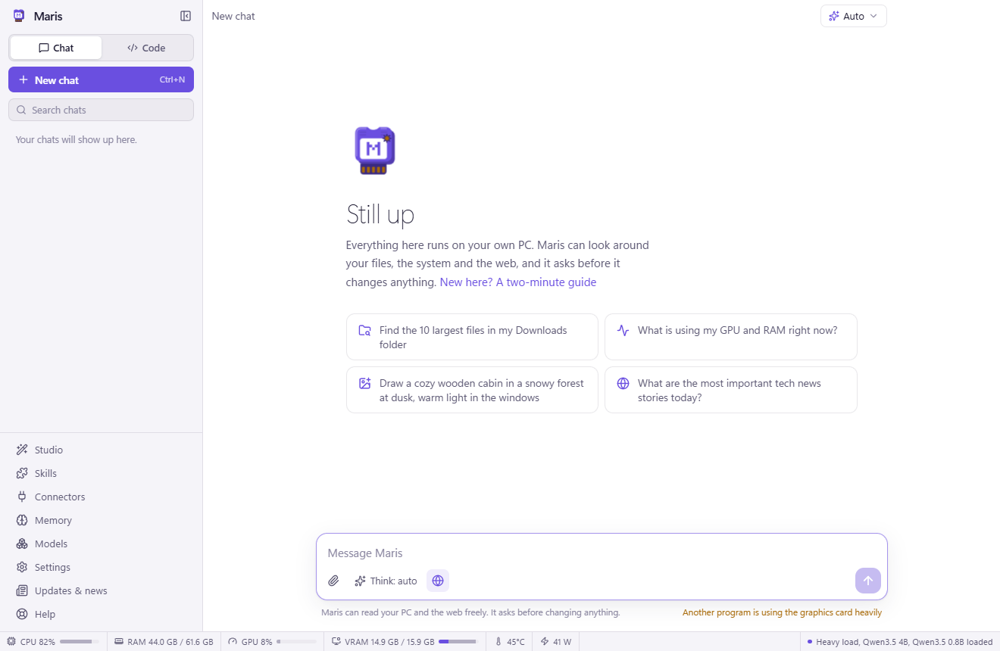
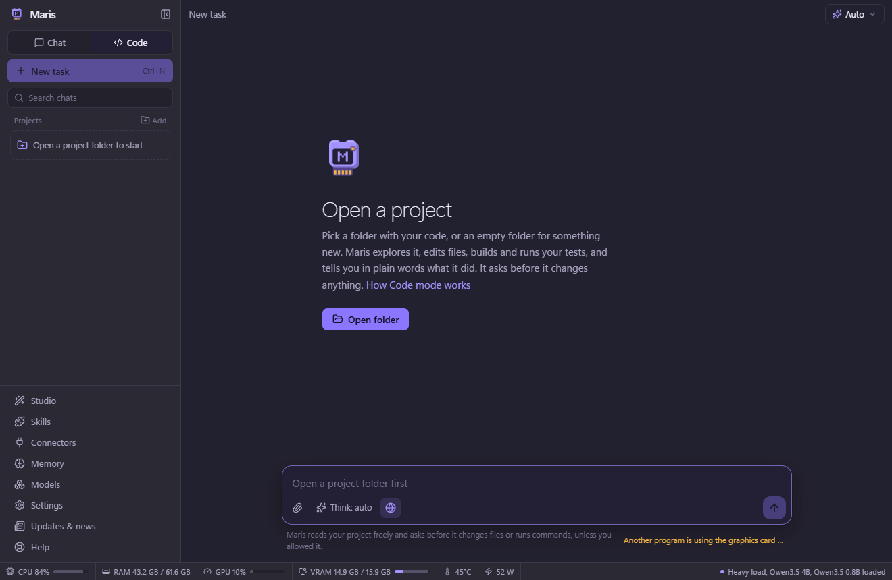
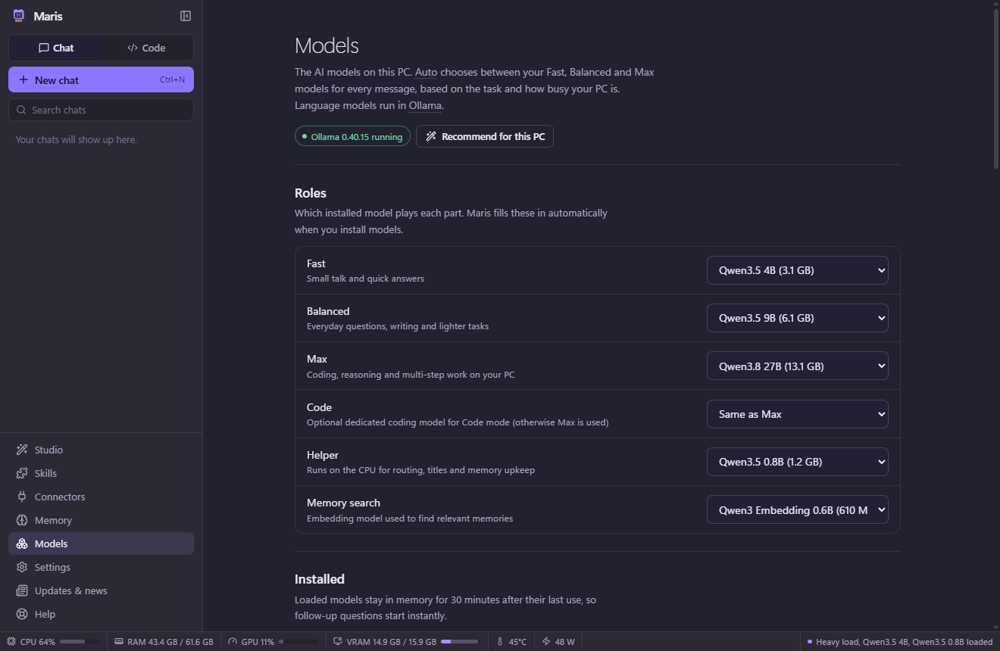
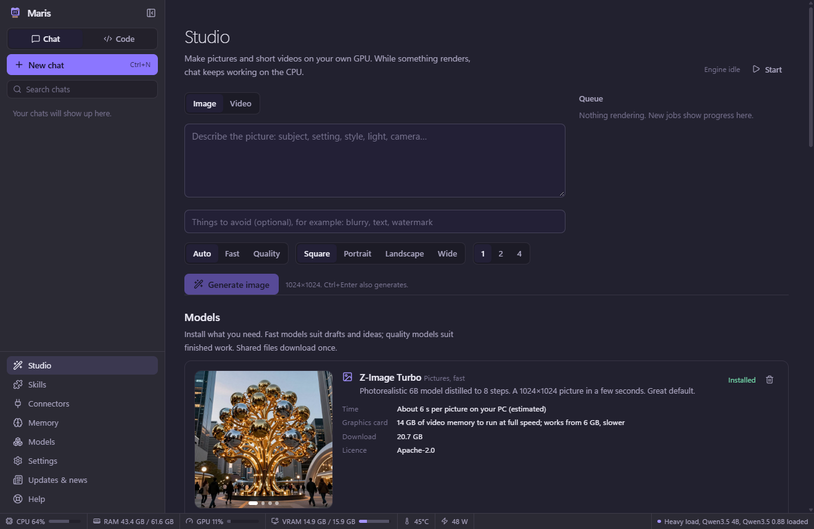
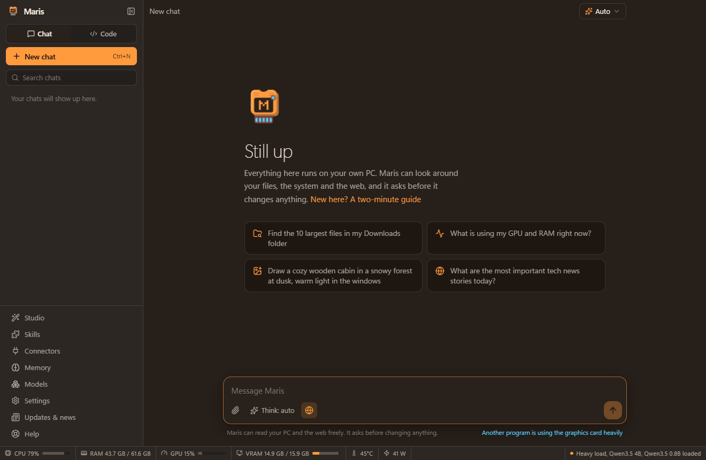
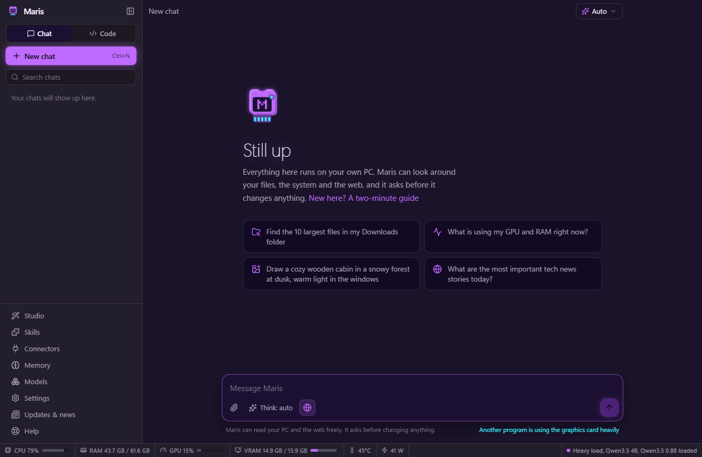
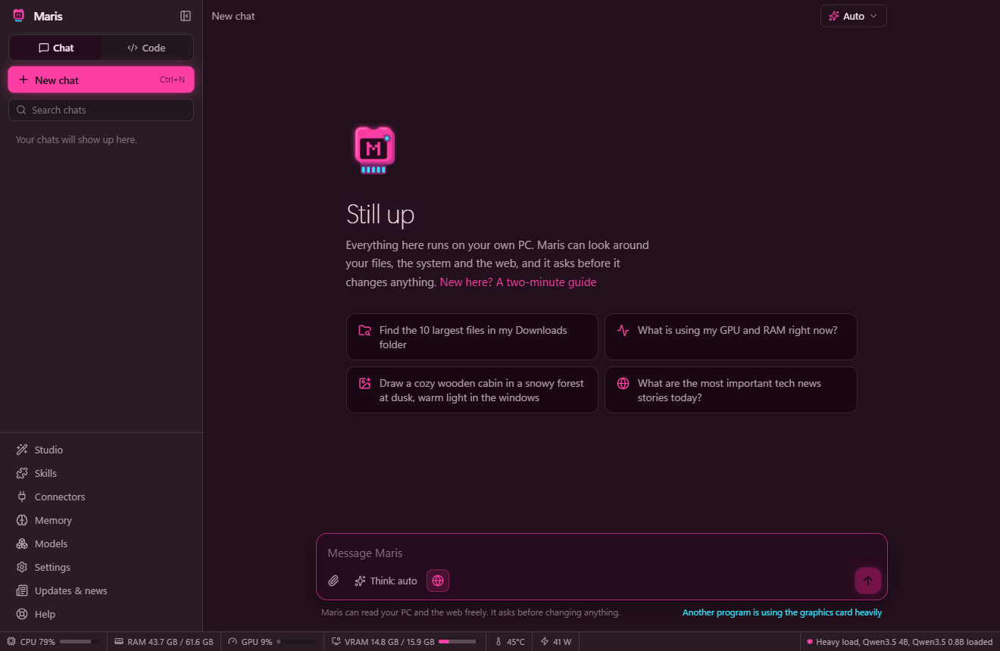
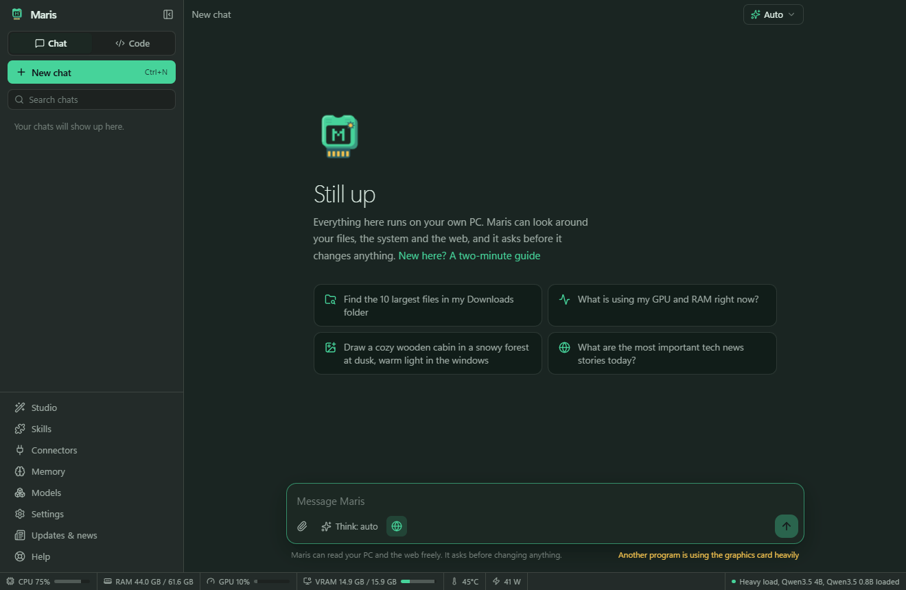
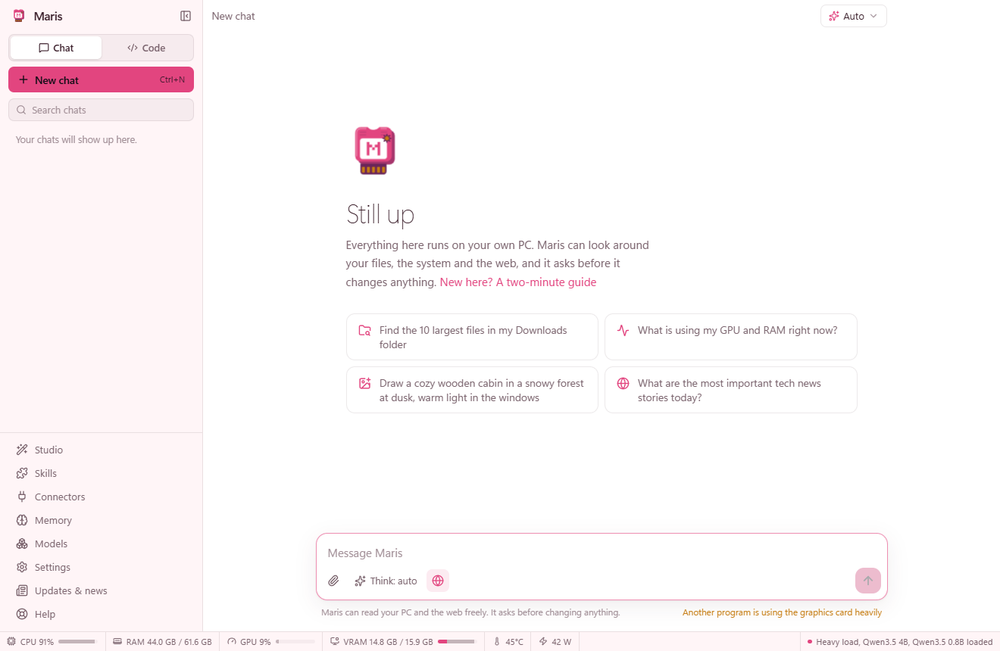
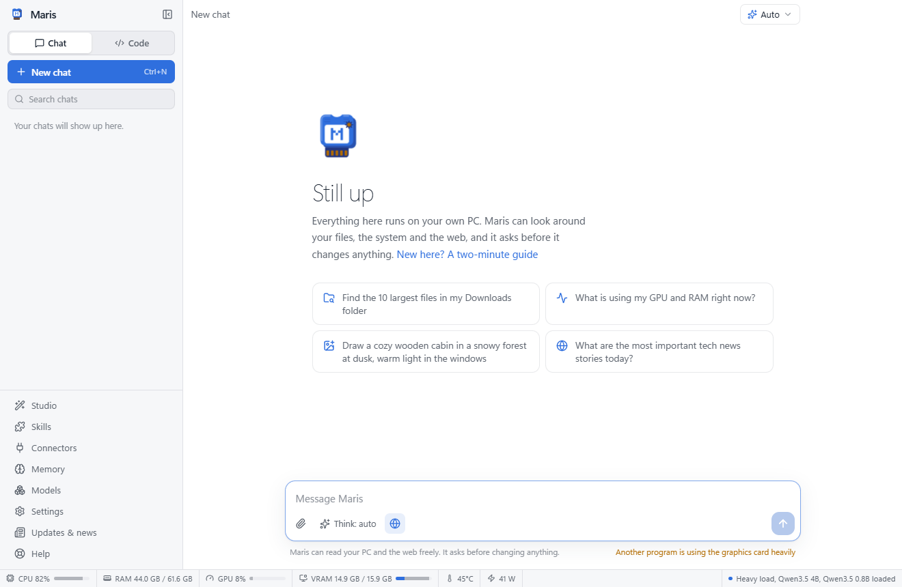

<p align="center">
  
</p>

# Maris — a private AI assistant for Windows, macOS and Linux, with an Android app

Maris runs entirely on your computer: chat, a coding agent that works on your projects, a PC assistant that can look at anything but **changes nothing without your approval**, long-term memory that learns, web browsing, and image/video generation — with the model picked automatically for each message based on the task and how busy your machine is.

It adapts to whatever is installed: the setup assistant scans the computer and picks models that run well on it, with or without a graphics card. It runs on **Windows**, **macOS** (Apple chips use Metal for chat and MPS for pictures and video) and **Linux** (NVIDIA CUDA, AMD ROCm, Intel Arc or CPU), and the **Android app** lets you use it from your phone over your home Wi-Fi, end-to-end encrypted.

> The source code and installer are not published here yet. For now this repository holds the overview and screenshots.

<p align="center">
  
</p>

## Screenshots

**Nothing changes without your OK.** Creating, editing, moving or deleting files, and any command that changes the PC, waits for Approve or Deny.


**Setup assistant.** It scans the PC, then recommends where models run and which ones to install.

<table>
  <tr>
    <td width="50%"></td>
    <td width="50%"></td>
  </tr>
  <tr>
    <td><b>Code mode</b> works on a project folder: explores, edits, builds and runs tests.<br></td>
    <td><b>Models</b>: which installed model plays each role (Fast, Balanced, Max, Code, Helper, Memory search).<br></td>
  </tr>
  <tr>
    <td><b>Studio</b>: images and short videos on your own GPU.<br></td>
    <td><b>Light mode</b>: the Maris theme in violet and gold.<br></td>
  </tr>
</table>

**Dark mode.** Every screen has a dark version.

<table>
  <tr>
    <td width="50%"></td>
    <td width="50%"></td>
  </tr>
  <tr>
    <td></td>
    <td></td>
  </tr>
</table>

**Themes.** Pick a built-in theme or build your own from five colours.

<table>
  <tr>
    <td width="33%"><b>Ember</b>: warm charcoal and amber<br></td>
    <td width="33%"><b>Neon Purple</b>: violet that glows<br></td>
    <td width="33%"><b>Neon Pink</b>: hot pink on plum<br></td>
  </tr>
  <tr>
    <td><b>Midnight</b>: deep navy and sky blue<br></td>
    <td><b>Forest</b>: pine green and mint<br></td>
    <td><b>Sakura</b>: blossom pink on warm white<br></td>
  </tr>
  <tr>
    <td><b>Daylight</b>: crisp white and blue<br></td>
    <td></td>
    <td></td>
  </tr>
</table>

The always-on status bar at the bottom of every screen shows CPU, RAM, GPU, VRAM, temperature, power and the loaded models.

## Install

### Windows

Run `release\windows\Maris-Setup-0.1.0.exe` (not published here yet). It installs per user (no admin rights) or for everyone, lets you pick the folder, and adds a Start menu entry. An **Extras** page then offers:

- a **desktop shortcut**;
- the **`maris` terminal command** on PATH, to chat from Terminal, PowerShell or Command Prompt (see [Terminal command](#terminal-command-maris));
- **“Open in Maris”** in the right-click menu of folders, which opens the folder as a Code project (on Windows 11 under *Show more options*);
- **starting Maris in the background** when you sign in, so answers and the terminal command start without delay.

The choices are remembered for updates and undone when Maris is uninstalled (a PATH entry is only ever added or removed as a whole, and a PATH close to Windows' length limit is left untouched). The installer is not code-signed, so Windows SmartScreen asks once: choose **More info → Run anyway**.

When the installer finishes, Maris opens its **setup assistant**:

1. **Scan** — reads the graphics card (NVIDIA, AMD, Intel; VRAM, driver, compute capability), CPU, RAM type and speed, free disk space, and whether Ollama and ComfyUI are already there. Nothing is changed.
2. **This PC** — choose where models run: **GPU only** (fastest, everything fits in VRAM), **GPU + CPU** (bigger models that overflow into RAM) or **CPU only** (no graphics card needed). Each option previews the strongest model it gets and how fast it writes. Switch image and video generation on or off and pick the data folder.
3. **Models** — a recommended model for every role (Fast, Balanced, Max, Code, Helper, Memory search, Images fast/quality, Video fast/quality), each with a bar showing how it sits in VRAM and RAM, a speed estimate and its download size. Swap any of them.
4. **Install** — installs Ollama if it is missing (winget or the official installer), downloads the models one at a time and the right ComfyUI build for the GPU. You can start using Maris while downloads continue.

Run it again any time from **Settings → Data and setup** or **Models → Recommend for this PC**.

### macOS

Open `Maris-0.1.0-arm64.dmg` (Apple chips) or `Maris-0.1.0-x64.dmg` (Intel) and drag Maris to Applications. The app is not notarized by Apple yet, so the first start needs one extra step: right-click Maris → **Open** (on macOS 15: try to open it once, then System Settings → Privacy & Security → **Open Anyway**).

- **Apple chips (M1 and newer):** language models run on the GPU through Metal, using the share of unified memory macOS gives the graphics (about two thirds of RAM, three quarters from 36 GB). Pictures and video use PyTorch with MPS.
- **Intel Macs:** language models run on the CPU; image and video generation needs an Apple chip.
- Setup installs Ollama into `~/Applications` (no administrator password) and ComfyUI with a private Python made by [uv](https://github.com/astral-sh/uv) inside the data folder (`~/MarisData` by default). Commands run in your login shell (zsh), and the app has a normal menu bar, ⌘ shortcuts, a menu-bar icon and macOS vibrancy for the Mica/Acrylic setting.

### Linux

| Package | How to install |
| --- | --- |
| `Maris-0.1.0-x86_64.AppImage` | `chmod +x Maris-*.AppImage` and run it. Works on most distributions. |
| `maris_0.1.0_amd64.deb` | Debian, Ubuntu, Mint, Pop!_OS: `sudo apt install ./maris_0.1.0_amd64.deb` |
| `maris-0.1.0.x86_64.rpm` | Fedora, openSUSE, RHEL: `sudo dnf install ./maris-0.1.0.x86_64.rpm` |
| `maris-0.1.0-linux-x64.tar.gz` | Any distribution: unpack and run `./maris` (if it refuses to start, run `sudo chown root chrome-sandbox && sudo chmod 4755 chrome-sandbox` in that folder once). |

ARM64 builds (for example a Raspberry Pi 5 or an ARM laptop) come from the same workflow. Setup installs Ollama with its official script, which asks for your password in the desktop's own dialog (it adds the GPU libraries and a background service). The scan reads NVIDIA cards through `nvidia-smi`, AMD and Intel cards through `/sys/class/drm` and `lspci` (no administrator rights needed), and picks the matching PyTorch build for ComfyUI: CUDA 12.8 (or 12.6 for older cards), ROCm, Intel XPU or CPU. Commands run in your login shell (bash), and "Start with Linux" uses the desktop's autostart folder.

### Android

Install `app-debug.apk` on the phone (Android 7 or newer; allow installing apps from your browser or file manager when Android asks). Then:

1. On the computer: **Settings → Phone**, turn on **Allow the phone app to connect**, and press **Pair a phone**. Maris shows a QR code, the computer's address and a one-time code.
2. In the app on the phone: tap **Scan code** and point it at the QR code, or type the address and code.

The phone shows the same chats, Code mode, approvals, Studio gallery, memory and settings as the computer; everything still runs on the computer. See [Phone app and Maris Link](#phone-app-and-maris-link) for how the connection is protected.

## What is in the box

| Area | What it does |
| --- | --- |
| **Chat** | Streaming answers with Markdown, code highlighting, math, tables, thinking blocks, image/file attachments (paste or drag & drop), edit & resend, regenerate with another model, 👍/👎 feedback. While the model works between steps, a line with a timer says so; if Ollama's model process crashes in the middle of an answer, Maris starts that step again once. |
| **Code mode** | Pick a project folder, then Maris explores (`project_tree`, `grep`, `read_file` with line numbers), edits (`edit_file`, `multi_edit`, `write_file`), builds and tests (`run_command`), runs dev servers (`start_process` / `process_output` / `stop_process`), looks at images and screenshots, checks toolchains (`dev_environment`) and keeps a visible plan (`update_plan`). Long sessions are compacted into a running summary automatically (or with the Compact button). Side panel: file tree with preview, a **Changes** list with diffs and one-click revert from backups, toolchain installer, background processes and per-project allowed commands. **Projects** sit in the sidebar as a tree with their tasks underneath; hovering a project shows **+** (new task) and **…** (rename, *About this project*: a description every task in it reads, open the folder, remove). |
| **Auto model choice** | Every message is graded (category + complexity, optional tiny-model grading) and sent to the **Fast**, **Balanced** or **Max** model. It steps down when another program is using the GPU, when VRAM is short, on battery, or while images/videos render (chat then runs on the CPU). Code mode prefers Max (or a dedicated Code model) with a 32K context. Re-running an answer with a different model or rating it teaches the router. |
| **Approvals** | Reading files, folders, processes, system info, the web and read-only commands runs freely. Writing/editing/moving/deleting files, commands that change things, opening programs, killing processes, clipboard writes and forgetting memories wait for **Approve** by default. Deletes go to the Recycle Bin (Trash) and edited files are backed up first. Each approval box also has **Always approve** with a menu for how far it goes: *this kind of request* (file edits, deleting, commands, programs, clipboard, memories; system folders still ask), *a command in this project* (Code mode), *everything in this session* (this chat, until Maris closes) or *everything, everywhere*. While any of these is on, a bar above the message box and the status bar say so, and one click opens switches to change or end them (also in Settings → PC access). Install commands (winget, npm, pip) show how much they download and need on disk, and how much is free, before you decide. |
| **Memory** | Facts, preferences, instructions, projects, people and learned "skills" stored with embeddings (`qwen3-embedding:0.6b` on the CPU). Relevant memories are added to each chat. After a chat goes quiet, a model already in memory extracts durable knowledge, merges duplicates and updates superseded facts. Everything is editable in **Memory**. |
| **Web** | `web_search` (DuckDuckGo → Bing → Mojeek fallback, or Brave API / SearXNG) and `read_webpage` (hidden sandboxed Chromium + Readability → Markdown, with a page thumbnail in the chat). |
| **Skills** | Folders with a `SKILL.md` (the format of Anthropic's Agent Skills), installed from any git address, a GitHub link to one folder (git when installed, otherwise GitHub's zip download) or a local folder. The model sees each enabled skill's name and description and loads the instructions with `use_skill`; when the memory embedding model finds that a request clearly fits one skill, the prompt names it, so small models load it too. Turn each skill off, update or remove it on the **Skills** page. |
| **Connectors** | Services over the Model Context Protocol (MCP): GitHub, Notion, Hugging Face, Brave Search, Home Assistant, Context7, DeepWiki and Stripe ready to pick, plus any MCP server by address (Streamable HTTP, falling back to SSE) or as a program on the computer (stdio). Tools the service marks read-only run freely; all others wait for approval, with *actions in connected services* as a new **Always approve** kind. Keys are stored encrypted. |
| **Updates & news** | While online, Maris checks this repository's GitHub releases, says **Maris x.y.z is available** with the release notes, downloads the installer with progress and installs it on **Install now**. The same page shows news posts with pictures from the repository's `news/` folder; the sidebar marks new versions and unread posts. See [Updates, news and publishing posts](#updates-news-and-publishing-posts). |
| **Admin** | With a GitHub token that may write to the repository, an **Admin** page: write a post in Markdown with pictures (pick, paste or drop them), preview it, publish it to everyone in one commit, edit or remove published posts. |
| **Studio** | Image and video generation through ComfyUI: Z-Image Turbo (fast) and Z-Image Base (quality) for images, Wan 2.2 TI2V 5B (fast) and Wan 2.2 A14B with LightX2V 4-step LoRAs (quality, text→video and image→video) for video. Auto picks fast/quality from your wording; chat models are unloaded first so the GPU is free. Available to the assistant as `generate_image` / `generate_video`. Every model has a card with example pictures or clips in a slider (made from sample prompts on an RTX 5070 Ti), the prompt under each with **Use this prompt**, and how long one result takes on your PC (measured once you have used it, estimated from the PC scan before). While a picture or video is made, the chat shows the model, a progress bar, the time left, **Stop**, and buttons to switch to another installed model. Chats sent meanwhile wait for the graphics card when it is nearly done, or answer on the processor (quick questions with the small helper model) and say so. |
| **Always-on status bar** | CPU, RAM, GPU load, VRAM (Maris's share vs. other apps), temperature, power and which models are loaded. |
| **Help and explanations** | A Help page (sidebar or **F1**) with 23 plain-language articles: getting started, approvals, Code mode, Studio, the terminal command, updates and news, skills, connectors, your PC explained, models, setup, themes, shortcuts, troubleshooting, privacy and a glossary. Technical words across the app (VRAM, context window, tokens/s, LoRA…) are underlined; point at one for a short explanation, click to open the article. Buttons, tabs and settings explain themselves on hover. |
| **Simple or Detailed work view** | Simple view is for people who do not program: in Code mode each stretch of work is one quiet line like a thought (*Working on the calculator… · 12 s*, then *Worked for 1 min · 9 steps*) that opens into Maris's notes and the steps as plain sentences, without commands, code or diffs; plans are written in everyday words; approvals stay visible. Detailed view shows every command, path, diff and output. Switch at the top of a Code-mode chat or in Settings → Assistant; “Explain things for: Everyone / Developers” sets how Maris itself writes. |
| **Themes** | Maris (light/dark), Neon Purple and Neon Pink (glowing buttons, focus rings and logo), Sakura, Midnight, Forest, Ember, Daylight, and a Custom theme built from five colours with optional glow. |
| **Settings** | Every option is editable and searchable (over 100 of them): appearance, answer style, models per role, context windows, sampling per role (temperature, top-p/k, repeat penalty, longest answer, GPU/CPU placement), engine (processing mode, keep-alive, CPU threads, reserved VRAM, timeouts, Ollama address), load thresholds, agent limits, memory, web, image/video defaults and ComfyUI memory mode, status bar segments and refresh rate. Changed settings show a dot and a one-click reset; sections reset together; settings export to and import from a file. |
| **Desktop integration** | Windows: Mica/Acrylic window, tray icon. macOS: traffic-light window, app menu, ⌘ shortcuts, menu-bar icon, vibrancy. Linux: tray icon, XDG autostart. Everywhere: global shortcut (`Ctrl+Shift+Space`), notifications when an action needs approval, start with the system. |
| **Terminal command** | `maris` chats from any terminal with the same models, memory, tools and approvals as the window (single-key answers: y, n, a, s), streams Markdown with colours and word wrapping, takes piped input (`git diff \| maris "write a commit message"`), works on folders (`maris code .`), makes pictures (`maris image …`), and starts Maris in the background when it is not running. Chats started there show up in the app with a terminal mark. See [Terminal command](#terminal-command-maris). |
| **Phone app** | Android app that pairs with a one-time code and then shows chats, approvals, Code mode, the Studio gallery, memory and settings from the computer. Send photos and files from the phone; approve changes from the phone (can be turned off). |
| **Accessibility** | Full keyboard use, visible focus, screen-reader labels and live announcements, text size 85–140 %, high-contrast mode, reduced motion, light/dark/system themes and accent colours. |

## Works on other PCs too

The setup assistant picks from a catalog that covers PCs from no GPU to 24 GB+ cards:

| PC | Typical picks (GPU only unless noted) |
| --- | --- |
| No GPU, 32 GB RAM | CPU only: Gemma 4 E4B / Gemma 4 12B / Qwen3.6 35B-A3B (mixture of experts, usable on a CPU); Stable Diffusion 1.5 for pictures |
| 8 GB GPU | Qwen3.5 2B / 4B / 9B; Z-Image Turbo Lite (8-bit) for pictures; Wan 2.1 1.3B for video |
| 8 GB GPU + 32 GB RAM, GPU + CPU | Max becomes a 35B mixture-of-experts model that overflows into RAM |
| 16 GB GPU | Qwen3.5 4B / 9B / Qwen3.8 27B Q3; Z-Image Turbo + Base; Wan 2.2 5B + A14B |
| 24 GB GPU | Qwen3.8 27B Q4 fully on the GPU |

Language models: Qwen 3.5 / 3.6 / 3.8, Gemma 4, gpt-oss, Qwen3-Coder (Ollama). Images: Z-Image Turbo, Turbo Lite, Base, Stable Diffusion 1.5. Video: Wan 2.1 1.3B, Wan 2.2 5B and A14B (ComfyUI, with the NVIDIA, older-NVIDIA CUDA 12.6, AMD or Intel build chosen from the scan; unpacked with Windows' built-in `tar`, 7-Zip as a fallback).

## Models on this PC

| Role | Model | Why |
| --- | --- | --- |
| Max (and Code) | `qwen3.8:27b-q3` — Qwen3.8-27B UD-Q3_K_XL + vision projector | Fits fully in 16 GB at 16K context (~38 tok/s). Strongest coder that fits: SWE-bench Pro 61.7, LiveCodeBench v6 90.3. |
| Balanced | `qwen3.5:9b` | Tools, vision, thinking; fits next to a game. |
| Fast | `qwen3.5:4b` | ~170 tok/s for everyday chat. |
| Helper | `qwen3.5:0.8b` (CPU) | Routing, titles, memory upkeep without touching VRAM. |
| Memory search | `qwen3-embedding:0.6b` (CPU) | Multilingual embeddings. |

Optional: `qwen3-coder-next` (80B-A3B, 52 GB, mostly in RAM) and `qwen3-coder:30b` are in **Models → Get more models**. They are not needed: Qwen3.8-27B scores higher on the published coding benchmarks.

The 27B was built from `unsloth/Qwen3.8-27B-GGUF` (`Qwen3.8-27B-UD-Q3_K_XL.gguf` + `mmproj-BF16.gguf`) with Ollama's own `qwen3.8` renderer and `qwen3.5` parser, so tool calling, thinking and vision behave exactly like the official build.

## Toolchains for Code mode

Code mode → Tools shows what is installed and installs the rest with one click:

| System | How | What |
| --- | --- | --- |
| Windows | winget, haxelib | .NET 10 SDK (C#), Visual Studio 2026 Build Tools with C++ (also the Rust MSVC linker), CMake, LLVM/clang, Haxe, HaxeFlixel (lime, openfl, flixel, flixel-addons, flixel-tools, hxcpp), Rust, Python, Node.js |
| macOS | Homebrew (its installer opens in Terminal), Xcode command line tools, rustup, Microsoft's `dotnet-install.sh` | the same list, with Apple clang instead of Visual Studio |
| Linux | apt / dnf / pacman / zypper through the desktop's password dialog, rustup and `dotnet-install.sh` in your home folder | gcc and make, CMake and Ninja, clang, Haxe, HaxeFlixel, Rust, .NET, Python with venv and pip, Node.js |

## Architecture

```
Electron main process (Node 24)                     Renderer (React 19 + Tailwind 4)
├─ agent/        tool-calling loop, approvals,      ├─ Chat / Code views, tool cards, diffs
│                prompts, project context,          ├─ Studio, Memory, Models, Settings
│                compaction                         └─ always-on status bar
├─ router.ts     task grading + system-aware choice
├─ engines/      Ollama client (chat, embed, pull)
├─ media/        ComfyUI install/run, packs, jobs, GPU hand-off
├─ memory/       embeddings store + background learner
├─ tools/        files, shell (+ read-only classifier), code, processes,
│                system, web, memory, media
├─ web/          hidden sandboxed browser, search, Readability
├─ system/       PC scan and CPU/RAM/GPU monitor per OS (nvidia-smi, Windows counters,
│                Linux sysfs, macOS IOKit), busy level
├─ link/         Maris Link: encrypted LAN server for the phone app
├─ feed/         update check and download, news feed, admin publishing (GitHub API)
├─ skills/       installing skills (git, GitHub zip, folder), SKILL.md, use_skill, matching
├─ connectors/   MCP client: presets, HTTP and stdio servers, tools for the agent
├─ platform.ts   which OS, shell (PowerShell / zsh / bash), paths
└─ db.ts         SQLite (node:sqlite, FTS5) in the app's data folder

Phone app (mobile/): Capacitor Android shell around the same React interface
(src/renderer/remote), whose `maris` API goes over Maris Link instead of IPC.
```

Engines: **Ollama** for language models, **ComfyUI** (installed on demand into the data folder: the portable build on Windows, the source with a private Python elsewhere) for images and video.

## Phone app and Maris Link

Maris Link is off until you turn it on in **Settings → Phone**. While it is on, Maris listens on port 7341 for phones on your own network:

- **Only nearby networks.** Connections from public internet addresses are dropped; home networks, link-local and VPNs such as Tailscale (100.64.0.0/10) are allowed.
- **Pairing with a one-time code.** “Pair a phone” shows a 12-character code (60 bits) that works once and expires after 10 minutes. The phone and the computer exchange ECDH P-256 keys and derive the session key with HKDF from the shared secret, salted with the code. Someone listening on the Wi-Fi cannot compute the key, and someone in the middle would need the code; after five wrong tries the code is cancelled.
- **Everything is encrypted.** Every request, answer, live update, picture and upload is sealed with AES-256-GCM and carries a timestamp and a one-time number, so it cannot be read, changed or replayed. The key is stored with the operating system's keychain where available (Electron safeStorage).
- **The computer stays in charge.** The phone cannot open dialogs or folders on the computer, run setup, install updates, publish news posts, change the link settings or pair other devices. Approving changes from the phone can be turned off (then you approve at the computer); without that right the phone also cannot turn on "Always approve" rules, only turn them off. **Remove** in Settings → Phone cuts a phone off immediately.

`tests/link.test.ts` checks the phone and computer halves of the encryption against each other; `tests/e2e/link.mjs` checks the whole server against a running Maris (wrong codes, replays, tampering, blocked actions, removal).

## Terminal command (`maris`)

`maris` is the chat in your terminal. It runs on Maris's own runtime and talks to the running app over a local pipe that only you can open (a fresh name and token on every start, kept in your profile), so it shares the app's models, memory, tools, chats and approvals. If Maris is not running, the command starts it in the background.

```text
maris                                 chat (type /help inside; Ctrl+C stops an answer, Ctrl+D leaves)
maris "how much space is left on C:?" ask once; the answer goes to standard output
maris code . "fix the failing test"   work on this folder in Code mode
git diff | maris "write a commit message for this"
maris -f photo.jpg "what plant is this?"
maris image "a red fox in fresh snow" --open
maris -c                              continue your last terminal chat
maris chats / maris open <id>         list chats / show one in the window
maris status / maris models           what is running / what is installed
```

When Maris wants to change something it asks right there: **y** allow, **n** deny, **a** always allow this kind of request, **s** allow everything in this chat, **d** details (the diff of a file change). When the terminal cannot ask (input piped in), the request waits in the Maris window instead. With output piped or `NO_COLOR` set, it prints plain text with no colours or animation; `--plain` forces that.

Installing it: the Windows installer's Extras page (on by default) puts `…\Maris\bin` on PATH; Settings → Window and startup → **Terminal command** turns it on or off later, also on macOS (`/usr/local/bin/maris`, asks for your password) and Linux (`~/.local/bin/maris`; not for the AppImage). On Windows the command is `bin\maris.exe`, a 26 KB launcher compiled from `resources/cli/MarisLauncher.cs` with the C# compiler that ships with Windows; a real console program means Ctrl+C never triggers cmd's "Terminate batch job?" question. Windows does not let a window program such as Maris.exe read a console's keys as a terminal, so in a console the launcher switches the keyboard to raw keys and passes them on (line editing, history with the arrow keys, single-key answers and Ctrl+C all work); a Maris the command starts in the background is started through `Start-Process` so it never holds on to the command's output pipes.

## Updates, news and publishing posts

Everything comes from the public GitHub repository set in **Settings → Updates and news** (default `MarySueXLsD/Maris-Local-AI`), so there is no server to run:

- **Updates.** While online, Maris asks GitHub for the repository's latest release every 6 hours (and on **Check now**). When its tag, such as `v0.2.0`, is newer than the running version, the sidebar shows a badge and **Updates & news** offers the file for this computer: the Windows installer, the macOS dmg for the chip, or the Linux AppImage. **Install now** runs the installer and closes Maris (Windows), opens the dmg (macOS) or shows the AppImage in its folder (Linux). The release text appears as *What is new*. Nothing is installed without that click.
- **News.** `news/index.json` lists the posts; each post is `news/posts/<id>.md`, with its pictures in `news/images/<id>/`. Maris reads them from raw.githubusercontent.com and keeps the posts and pictures in the app data folder, so posts that were read once also open offline.

**Shipping an update:** set `version` in `package.json`, optionally write the notes in `release-notes/v0.2.0.md`, commit, and push the tag `v0.2.0`. The build workflow checks that the tag matches the version, builds every platform and publishes the GitHub release with the installers and the Android app. Without a notes file, GitHub writes the notes from the changes since the last release.

**Publishing posts as the admin:**

1. On GitHub, create a fine-grained personal access token for this repository only, with **Contents: Read and write**.
2. In Maris, turn on Settings → Updates and news → **Show the Admin page**, open **Admin** in the sidebar and paste the token. Maris checks that the token may write to the repository and keeps it encrypted (Electron safeStorage).
3. Write the post in Markdown and add pictures: pick them, paste them or drop them into the text. The first picture becomes the cover in the list; the star on another picture picks that one instead. Check **Preview**, then **Publish**. The Markdown, the pictures and the updated list go to `main` in one commit. **Edit** and **Remove for everyone** work the same way.

Copies of Maris that are online show a new post the next time they look (every 6 hours by default, or right away with **Check now**). The phone app cannot publish, install updates or see the token. `tests/e2e/news.mjs` tests all of this against a local stand-in for GitHub, never the real repository.

## Develop

```bash
npm install
npx install-electron          # fetches the Electron binary (npm 11 no longer runs it automatically)
npm run dev                   # hot-reloading app
npm test                      # unit tests: command classifier, recommender (simulated PCs), settings coverage, media packs
npm run build                 # production bundle in out/, plus the maris command (out/cli) and its Windows launcher (out/cli-bin)
npm run dist                  # Windows installer in release/windows/ (the unpacked app is in release/windows/win-unpacked)
npm run dist:linux            # Linux AppImage, deb, rpm and tar.gz in release/linux/ (needs Linux)
npm run dist:linux:win        # on Windows: the Linux tar.gz in release/linux/, with Linux file permissions fixed
npm run dist:mac              # macOS dmg and zip for Apple chips and Intel in release/macos/ (needs a Mac)
npm run mobile:build          # the phone app's web part in mobile/www
npm run mobile:apk            # Android debug APK (needs a JDK 17+ and the Android SDK)
python scripts/make-platform-icons.py   # icon.icns, the macOS menu-bar icon and the Android launcher icons
node tests/e2e/smoke.mjs <dir>       # end-to-end: chat, tools, approve, deny, views
node tests/e2e/code.mjs <dir>        # end-to-end: Code mode fixes a failing test
node tests/e2e/setup.mjs <dir>       # end-to-end: setup assistant (scan → plan → finish) and every Settings section
node tests/e2e/setup-pcs.mjs <dir>   # the setup assistant on simulated PCs (no GPU, 8 GB NVIDIA, 24 GB AMD)
node tests/e2e/media.mjs <dir> "Z-Image Turbo" image "a prompt"
node tests/workflows.mjs             # every image/video workflow against a running ComfyUI
node tests/e2e/link.mjs <dir> [--hold]        # Maris Link against the real app; --hold waits with a pairing code
node tests/e2e/approve-rules.mjs <dir>        # "Always approve": kind, session and everything rules, and turning them off
node tests/e2e/android.mjs <dir> [--browser]  # the phone app: pairs, chats, approves a change (emulator via adb, or Edge as a Pixel 7)
node tests/e2e/news.mjs <dir>                # update check and download, news posts, publishing/editing/removing posts (stand-in GitHub)
node tests/e2e/extensions.mjs <dir>          # installs a skill and checks the model uses it; a test MCP server through the Connectors page
node tests/e2e/cli.mjs <dir>                 # the maris command (bin\maris.exe): answers, piped input, approvals, chats, starting Maris (needs MARIS_EXE)
node tests/installer/check-path.cjs           # the installer's PATH editing, on a scratch registry key
node scripts/make-previews.mjs [pack…]       # renders the model-card examples with the installed picture/video models (needs MARIS_EXE)
npx electron scripts/make-installer-art.cjs   # installer sidebar/header bitmaps
```

**All platforms at once:** `.github/workflows/build.yml` runs the tests on Windows, macOS and Linux, then builds the Windows installer, the macOS dmg/zip (Apple chips and Intel), Linux packages (x64 and ARM64) and the Android APK. Start it from the Actions tab and the files appear on the run's page; push a tag such as `v0.2.0` and it also publishes them as a GitHub release, which installed copies offer as an update (see [Shipping an update](#updates-news-and-publishing-posts)).

End-to-end tests use a throwaway profile. `MARIS_EXE=release\windows\win-unpacked\Maris.exe` tests a packaged build; `MARIS_ELECTRON=<electron.exe>` runs this folder with another Electron binary.

Data: app database and settings in `%APPDATA%\Maris` (Windows), `~/Library/Application Support/Maris` (macOS) or `~/.config/Maris` (Linux); engines, media models and creations in the data folder (Settings → Data and setup; default: the drive with the most free space on Windows, `~/MarisData` elsewhere).

## Notes from testing on this PC

- **Antivirus:** Norton 360's behaviour shield suspended the app when it launched `powershell -EncodedCommand` (a pattern malware uses), and later quarantined the development copy of Electron (`node_modules\electron\dist\electron.exe`). Maris now runs every command from a temporary `.ps1` file, the way IDEs and build tools do. To develop again, restore that file from Norton's Security History (or exclude this folder and run `npx install-electron`). If Norton ever blocks the installed app, add an exclusion for `Maris.exe`.
- **Packaging behind Norton:** Norton now and then stops electron-builder's packers halfway without an error. If `release/windows` has no installer (or a leftover `.nsis.7z`), build it again from the unpacked app: `npx electron-builder --win nsis --x64 --prepackaged release/windows/win-unpacked -c.directories.output=release/windows`. A damaged Linux tar.gz is rebuilt from `release/linux/linux-unpacked` by `scripts/fix-linux-tar.py`, which `npm run dist:linux:win` runs anyway.
- **ComfyUI start-up:** ComfyUI pins about 40% of system RAM at start by default, which stalled for minutes while other programs were using memory. Maris starts it with `--disable-pinned-memory`. The very first start still takes 2–3 minutes; later starts are faster.
- **Android builds behind Norton:** Norton's HTTPS scanning replaces certificates with its own, which Java does not trust, so Gradle could not download anything. Running Gradle with `JAVA_TOOL_OPTIONS="-Djavax.net.ssl.trustStoreType=Windows-ROOT -Djavax.net.ssl.trustStore=NONE"` (and the Adoptium JDK, which has the Windows certificate store module) makes Java use the Windows certificate store instead; nothing in Norton was changed. Capacitor's Android Gradle Plugin 8.13 needs a Gradle older than 9.6, so the project pins Gradle 9.5 (which also runs on JDK 25).
- **Android emulator:** Norton also suspended the emulator (`qemu-system-x86_64.exe`) as soon as it started, so the phone app was tested with the same web bundle in Edge as a Pixel 7 against the real desktop app (`tests/e2e/android.mjs --browser`), and the APK was built but not run here. To use the emulator, allow it in Norton or test on a phone over USB.
- **macOS and Linux:** this PC has no Mac and no Linux, so those builds come from the GitHub workflow. The Linux tar.gz was cross-built here; the Linux and macOS scanners, shells and engine installers are covered by unit tests with real sample output but have not run on those systems yet.
- **Context vs speed:** Qwen3.8-27B at 32K context spills 12% into system RAM and drops from ~38 to ~16 tokens/s. In Code mode, Auto therefore picks the largest context that still fits fully on the GPU (16K here) and relies on automatic compaction for long sessions.

## Tips

- For long Code-mode sessions you can trade a little speed for a bigger window: Settings → Auto model choice → Context window → Code mode 48K/64K.
- If a game is running, Auto steps down to the Fast model on its own; you can still pick Max from the model menu.
- `git` reports "dubious ownership" on exFAT drives such as H:. Fix it once with `git config --global --add safe.directory H:/Projects/Personal/Local_AI`.
