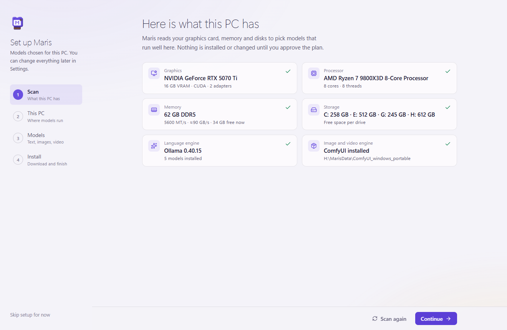
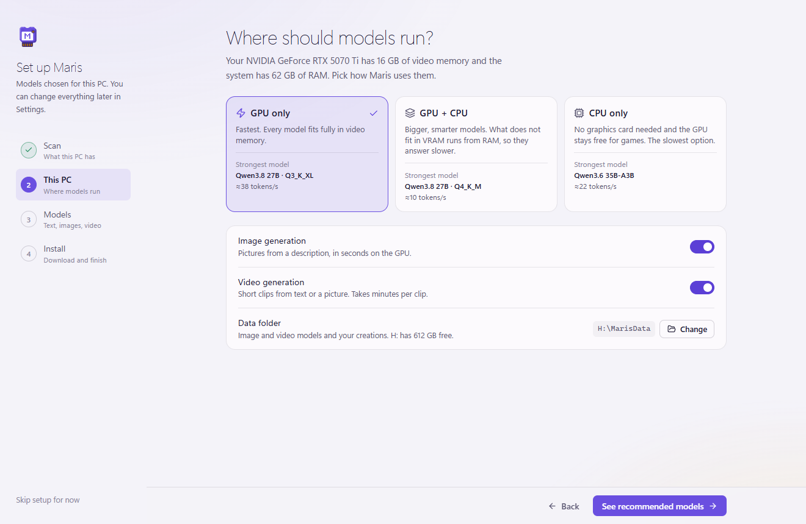
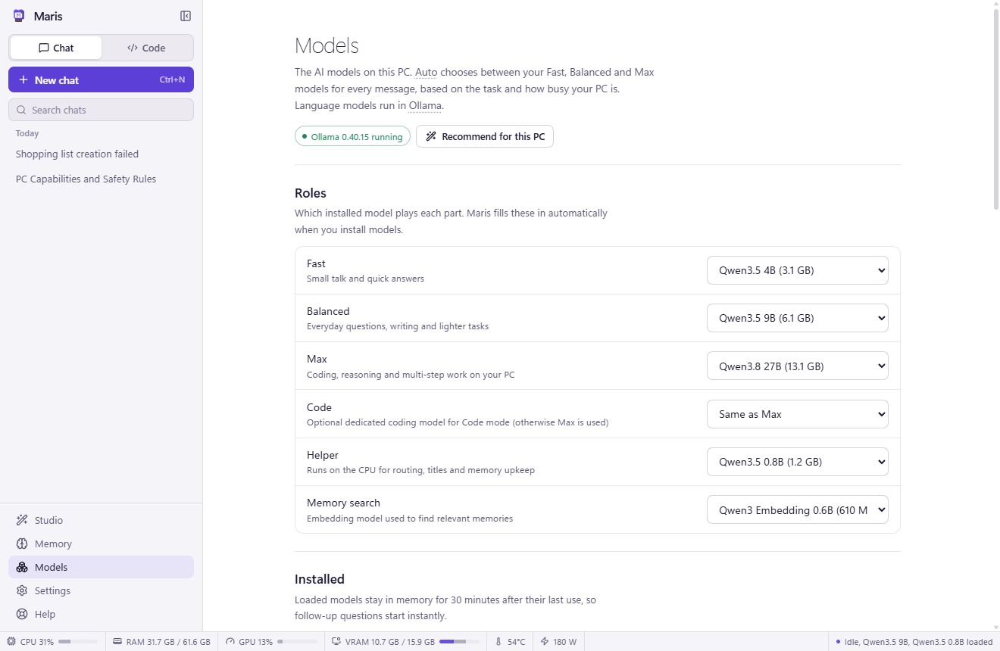
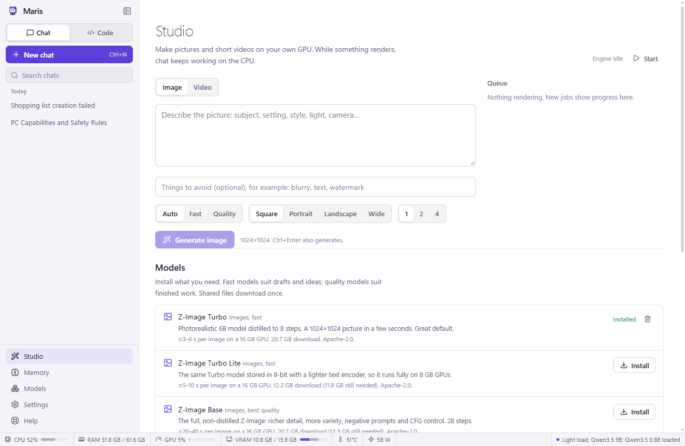
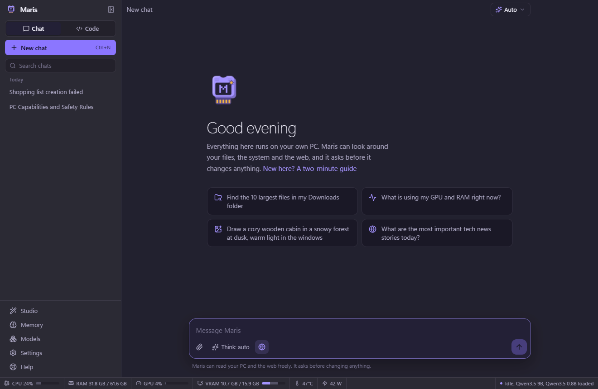

<p align="center">
  
</p>

# Maris — a private AI assistant for Windows

Maris runs entirely on your PC: chat, a coding agent that works on your projects, a PC assistant that can look at anything but **changes nothing without your approval**, long-term memory that learns, web browsing, and image/video generation — with the model picked automatically for each message based on the task and how busy your machine is.

Built for an RTX 5070 Ti (16 GB) + Ryzen 7 9800X3D + 62 GB RAM, but it adapts to whatever is installed.

> The source code and installer are not published here yet. For now this repository holds the overview and screenshots.

<p align="center">
  
</p>

## Screenshots

**Nothing changes without your OK.** Creating, editing, moving or deleting files, and any command that changes the PC, waits for Approve or Deny.


**Setup assistant.** It scans the PC, then recommends where models run and which ones to install.

<table>
  <tr>
    <td width="50%"></td>
    <td width="50%"></td>
  </tr>
  <tr>
    <td><b>Code mode</b> works on a project folder: explores, edits, builds and runs tests.<br></td>
    <td><b>Models</b>: which installed model plays each role (Fast, Balanced, Max, Code, Helper, Memory search).<br></td>
  </tr>
  <tr>
    <td><b>Studio</b>: images and short videos on your own GPU.<br></td>
    <td><b>Dark theme.</b> Neon, Sakura, Midnight and other themes, or build your own.<br></td>
  </tr>
</table>

The always-on status bar at the bottom of every screen shows CPU, RAM, GPU, VRAM, temperature, power and the loaded models.

## Install

Run `release\Maris-Setup-0.1.0.exe` (not published here yet). It installs per user (no admin rights), lets you pick the folder, and adds Start menu and desktop shortcuts. The installer is not code-signed, so Windows SmartScreen asks once: choose **More info → Run anyway**.

When the installer finishes, Maris opens its **setup assistant**:

1. **Scan** — reads the graphics card (NVIDIA, AMD, Intel; VRAM, driver, compute capability), CPU, RAM type and speed, free disk space, and whether Ollama and ComfyUI are already there. Nothing is changed.
2. **This PC** — choose where models run: **GPU only** (fastest, everything fits in VRAM), **GPU + CPU** (bigger models that overflow into RAM) or **CPU only** (no graphics card needed). Each option previews the strongest model it gets and how fast it writes. Switch image and video generation on or off and pick the data folder.
3. **Models** — a recommended model for every role (Fast, Balanced, Max, Code, Helper, Memory search, Images fast/quality, Video fast/quality), each with a bar showing how it sits in VRAM and RAM, a speed estimate and its download size. Swap any of them.
4. **Install** — installs Ollama if it is missing (winget or the official installer), downloads the models one at a time and the right ComfyUI build for the GPU. You can start using Maris while downloads continue.

Run it again any time from **Settings → Data and setup** or **Models → Recommend for this PC**.

## What is in the box

| Area | What it does |
| --- | --- |
| **Chat** | Streaming answers with Markdown, code highlighting, math, tables, thinking blocks, image/file attachments (paste or drag & drop), edit & resend, regenerate with another model, 👍/👎 feedback. |
| **Code mode** | Pick a project folder, then Maris explores (`project_tree`, `grep`, `read_file` with line numbers), edits (`edit_file`, `multi_edit`, `write_file`), builds and tests (`run_command`), runs dev servers (`start_process` / `process_output` / `stop_process`), looks at images and screenshots, checks toolchains (`dev_environment`) and keeps a visible plan (`update_plan`). Long sessions are compacted into a running summary automatically (or with the Compact button). Side panel: file tree with preview, a **Changes** list with diffs and one-click revert from backups, toolchain installer, background processes and per-project allowed commands. |
| **Auto model choice** | Every message is graded (category + complexity, optional tiny-model grading) and sent to the **Fast**, **Balanced** or **Max** model. It steps down when another program is using the GPU, when VRAM is short, on battery, or while images/videos render (chat then runs on the CPU). Code mode prefers Max (or a dedicated Code model) with a 32K context. Re-running an answer with a different model or rating it teaches the router. |
| **Approvals** | Reading files, folders, processes, system info, the web and read-only PowerShell runs freely. Writing/editing/moving/deleting files, commands that change things, opening programs, killing processes, clipboard writes and forgetting memories always wait for **Approve**. Deletes go to the Recycle Bin and edited files are backed up first. In Code mode you can opt in to *auto-approve edits inside this project* (per chat) and *always allow* a specific command prefix such as `cargo test` (per project). |
| **Memory** | Facts, preferences, instructions, projects, people and learned "skills" stored with embeddings (`qwen3-embedding:0.6b` on the CPU). Relevant memories are added to each chat. After a chat goes quiet, a model already in memory extracts durable knowledge, merges duplicates and updates superseded facts. Everything is editable in **Memory**. |
| **Web** | `web_search` (DuckDuckGo → Bing → Mojeek fallback, or Brave API / SearXNG) and `read_webpage` (hidden sandboxed Chromium + Readability → Markdown, with a page thumbnail in the chat). |
| **Studio** | Image and video generation through ComfyUI: Z-Image Turbo (fast) and Z-Image Base (quality) for images, Wan 2.2 TI2V 5B (fast) and Wan 2.2 A14B with LightX2V 4-step LoRAs (quality, text→video and image→video) for video. Auto picks fast/quality from your wording; chat models are unloaded first so the GPU is free. Available to the assistant as `generate_image` / `generate_video`. |
| **Always-on status bar** | CPU, RAM, GPU load, VRAM (Maris's share vs. other apps), temperature, power and which models are loaded. |
| **Help and explanations** | A Help page (sidebar or **F1**) with 20 plain-language articles: getting started, approvals, Code mode, Studio, your PC explained, models, setup, themes, shortcuts, troubleshooting, privacy and a glossary. Technical words across the app (VRAM, context window, tokens/s, LoRA…) are underlined; point at one for a short explanation, click to open the article. Buttons, tabs and settings explain themselves on hover. |
| **Simple or Detailed work view** | In Simple view (default) Maris describes every step in plain words, e.g. “Ran the Python tests — both passed” or “Changed calc.py +1 −1”, groups the quiet steps, folds commands and code away and ends with a summary (“Tests pass”). Installs, deletions, git history changes and chained or unknown commands are always shown in full. Detailed view shows every command, path and change. Switch at the top of a Code-mode chat or in Settings → Assistant; “Explain things for: Everyone / Developers” sets how Maris itself writes. |
| **Themes** | Maris (light/dark), Neon Purple and Neon Pink (glowing buttons, focus rings and logo), Sakura, Midnight, Forest, Ember, Daylight, and a Custom theme built from five colours with optional glow. |
| **Settings** | Every option is editable and searchable (over 100 of them): appearance, answer style, models per role, context windows, sampling per role (temperature, top-p/k, repeat penalty, longest answer, GPU/CPU placement), engine (processing mode, keep-alive, CPU threads, reserved VRAM, timeouts, Ollama address), load thresholds, agent limits, memory, web, image/video defaults and ComfyUI memory mode, status bar segments and refresh rate. Changed settings show a dot and a one-click reset; sections reset together; settings export to and import from a file. |
| **Windows integration** | Windows 11 Mica window, tray icon, global shortcut (`Ctrl+Shift+Space`), notifications when an action needs approval, start with Windows. |
| **Accessibility** | Full keyboard use, visible focus, screen-reader labels and live announcements, text size 85–140 %, high-contrast mode, reduced motion, light/dark/system themes and accent colours. |

## Works on other PCs too

The setup assistant picks from a catalog that covers PCs from no GPU to 24 GB+ cards:

| PC | Typical picks (GPU only unless noted) |
| --- | --- |
| No GPU, 32 GB RAM | CPU only: Gemma 4 E4B / Gemma 4 12B / Qwen3.6 35B-A3B (mixture of experts, usable on a CPU); Stable Diffusion 1.5 for pictures |
| 8 GB GPU | Qwen3.5 2B / 4B / 9B; Z-Image Turbo Lite (8-bit) for pictures; Wan 2.1 1.3B for video |
| 8 GB GPU + 32 GB RAM, GPU + CPU | Max becomes a 35B mixture-of-experts model that overflows into RAM |
| 16 GB GPU | Qwen3.5 4B / 9B / Qwen3.8 27B Q3; Z-Image Turbo + Base; Wan 2.2 5B + A14B |
| 24 GB GPU | Qwen3.8 27B Q4 fully on the GPU |

Language models: Qwen 3.5 / 3.6 / 3.8, Gemma 4, gpt-oss, Qwen3-Coder (Ollama). Images: Z-Image Turbo, Turbo Lite, Base, Stable Diffusion 1.5. Video: Wan 2.1 1.3B, Wan 2.2 5B and A14B (ComfyUI, with the NVIDIA, older-NVIDIA CUDA 12.6, AMD or Intel build chosen from the scan; unpacked with Windows' built-in `tar`, 7-Zip as a fallback).

## Models on this PC

| Role | Model | Why |
| --- | --- | --- |
| Max (and Code) | `qwen3.8:27b-q3` — Qwen3.8-27B UD-Q3_K_XL + vision projector | Fits fully in 16 GB at 16K context (~38 tok/s). Strongest coder that fits: SWE-bench Pro 61.7, LiveCodeBench v6 90.3. |
| Balanced | `qwen3.5:9b` | Tools, vision, thinking; fits next to a game. |
| Fast | `qwen3.5:4b` | ~170 tok/s for everyday chat. |
| Helper | `qwen3.5:0.8b` (CPU) | Routing, titles, memory upkeep without touching VRAM. |
| Memory search | `qwen3-embedding:0.6b` (CPU) | Multilingual embeddings. |

Optional: `qwen3-coder-next` (80B-A3B, 52 GB, mostly in RAM) and `qwen3-coder:30b` are in **Models → Get more models**. They are not needed: Qwen3.8-27B scores higher on the published coding benchmarks.

The 27B was built from `unsloth/Qwen3.8-27B-GGUF` (`Qwen3.8-27B-UD-Q3_K_XL.gguf` + `mmproj-BF16.gguf`) with Ollama's own `qwen3.8` renderer and `qwen3.5` parser, so tool calling, thinking and vision behave exactly like the official build.

## Toolchains for Code mode

Code mode → Tools shows what is installed and installs the rest with one click (winget / haxelib):
.NET 10 SDK (C#), Visual Studio 2026 Build Tools with C++ (also the Rust MSVC linker), CMake, LLVM/clang, Haxe, HaxeFlixel (lime, openfl, flixel, flixel-addons, flixel-tools, hxcpp), Rust, Python, Node.js.

## Architecture

```
Electron main process (Node 24)                     Renderer (React 19 + Tailwind 4)
├─ agent/        tool-calling loop, approvals,      ├─ Chat / Code views, tool cards, diffs
│                prompts, project context,          ├─ Studio, Memory, Models, Settings
│                compaction                         └─ always-on status bar
├─ router.ts     task grading + system-aware choice
├─ engines/      Ollama client (chat, embed, pull)
├─ media/        ComfyUI install/run, packs, jobs, GPU hand-off
├─ memory/       embeddings store + background learner
├─ tools/        files, shell (+ read-only classifier), code, processes,
│                system, web, memory, media
├─ web/          hidden sandboxed browser, search, Readability
├─ system/       CPU/RAM/GPU monitor (nvidia-smi), busy level
└─ db.ts         SQLite (node:sqlite, FTS5) in %APPDATA%\Maris
```

Engines: **Ollama** for language models, **ComfyUI portable** (installed on demand into the data folder) for images and video.

## Develop

```bash
npm install
npx install-electron          # fetches the Electron binary (npm 11 no longer runs it automatically)
npm run dev                   # hot-reloading app
npm test                      # unit tests: command classifier, recommender (simulated PCs), settings coverage, media packs
npm run build                 # production bundle in out/
npm run dist                  # Windows installer in release/
node tests/e2e/smoke.mjs <dir>       # end-to-end: chat, tools, approve, deny, views
node tests/e2e/code.mjs <dir>        # end-to-end: Code mode fixes a failing test
node tests/e2e/setup.mjs <dir>       # end-to-end: setup assistant (scan → plan → finish) and every Settings section
node tests/e2e/setup-pcs.mjs <dir>   # the setup assistant on simulated PCs (no GPU, 8 GB NVIDIA, 24 GB AMD)
node tests/e2e/media.mjs <dir> "Z-Image Turbo" image "a prompt"
node tests/workflows.mjs             # every image/video workflow against a running ComfyUI
npx electron scripts/make-installer-art.cjs   # installer sidebar/header bitmaps
```

End-to-end tests use a throwaway profile. `MARIS_EXE=<Maris.exe>` tests a packaged build; `MARIS_ELECTRON=<electron.exe>` runs this folder with another Electron binary.

Data: app database and settings in `%APPDATA%\Maris`; engines, media models and creations in the data folder (Settings → Storage, default: the drive with the most free space).

## Notes from testing on this PC

- **Antivirus:** Norton 360's behaviour shield suspended the app when it launched `powershell -EncodedCommand` (a pattern malware uses), and later quarantined the development copy of Electron (`node_modules\electron\dist\electron.exe`). Maris now runs every command from a temporary `.ps1` file, the way IDEs and build tools do. To develop again, restore that file from Norton's Security History (or exclude this folder and run `npx install-electron`). If Norton ever blocks the installed app, add an exclusion for `Maris.exe`.
- **ComfyUI start-up:** ComfyUI pins about 40% of system RAM at start by default, which stalled for minutes while other programs were using memory. Maris starts it with `--disable-pinned-memory`. The very first start still takes 2–3 minutes; later starts are faster.
- **Context vs speed:** Qwen3.8-27B at 32K context spills 12% into system RAM and drops from ~38 to ~16 tokens/s. In Code mode, Auto therefore picks the largest context that still fits fully on the GPU (16K here) and relies on automatic compaction for long sessions.

## Tips

- For long Code-mode sessions you can trade a little speed for a bigger window: Settings → Auto model choice → Context window → Code mode 48K/64K.
- If a game is running, Auto steps down to the Fast model on its own; you can still pick Max from the model menu.
- `git` reports "dubious ownership" on exFAT drives such as H:. Fix it once with `git config --global --add safe.directory H:/Projects/Personal/Local_AI`.
