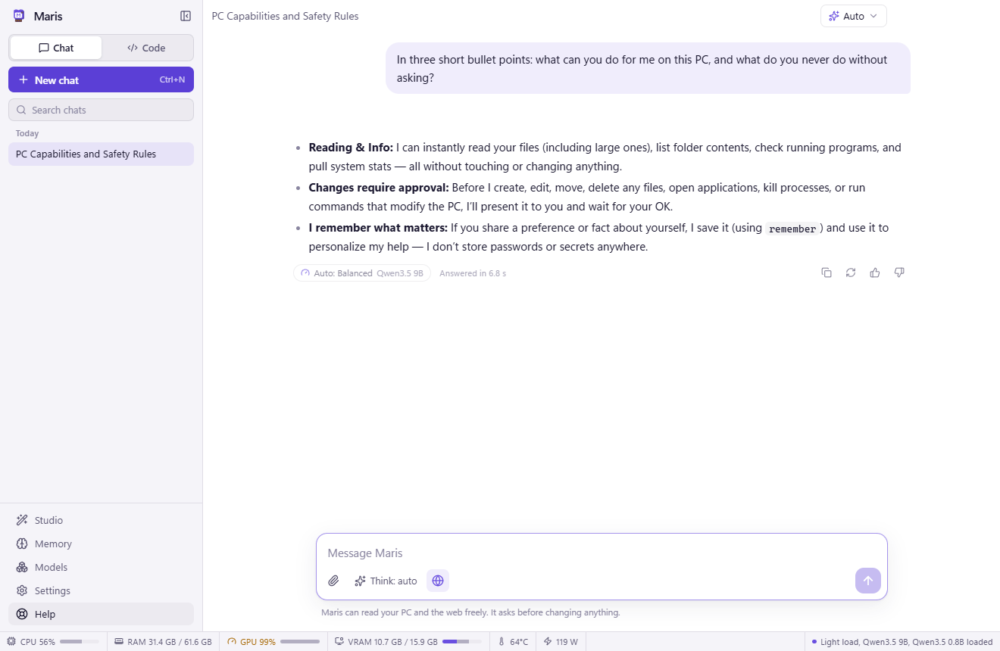
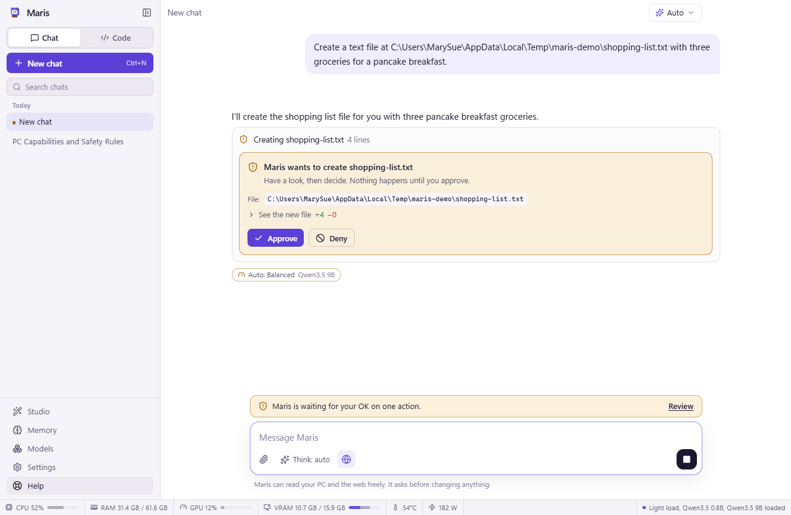
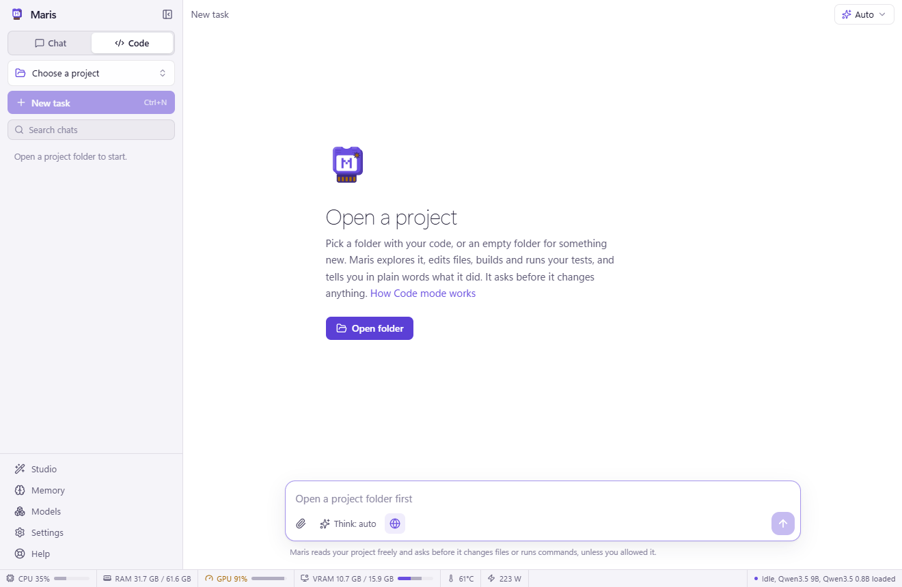
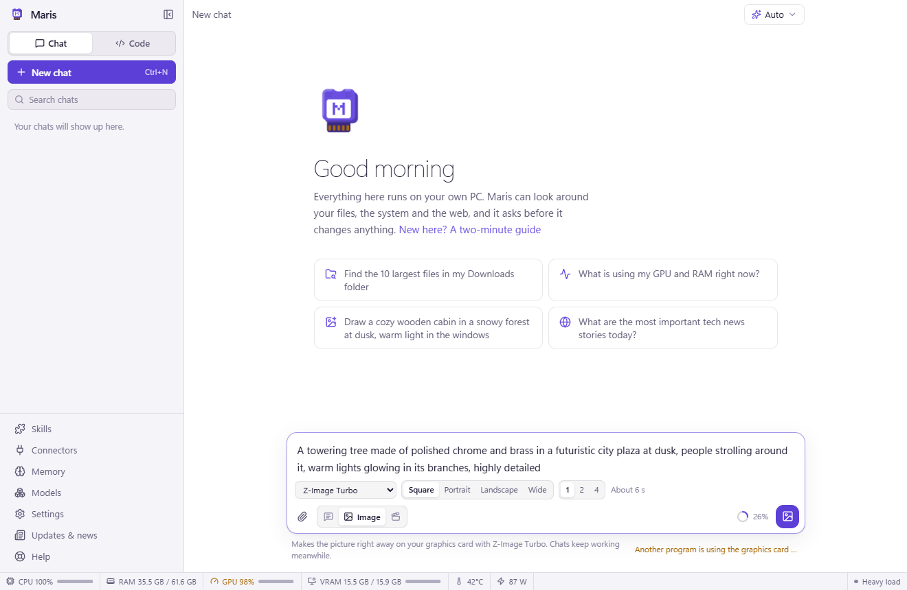
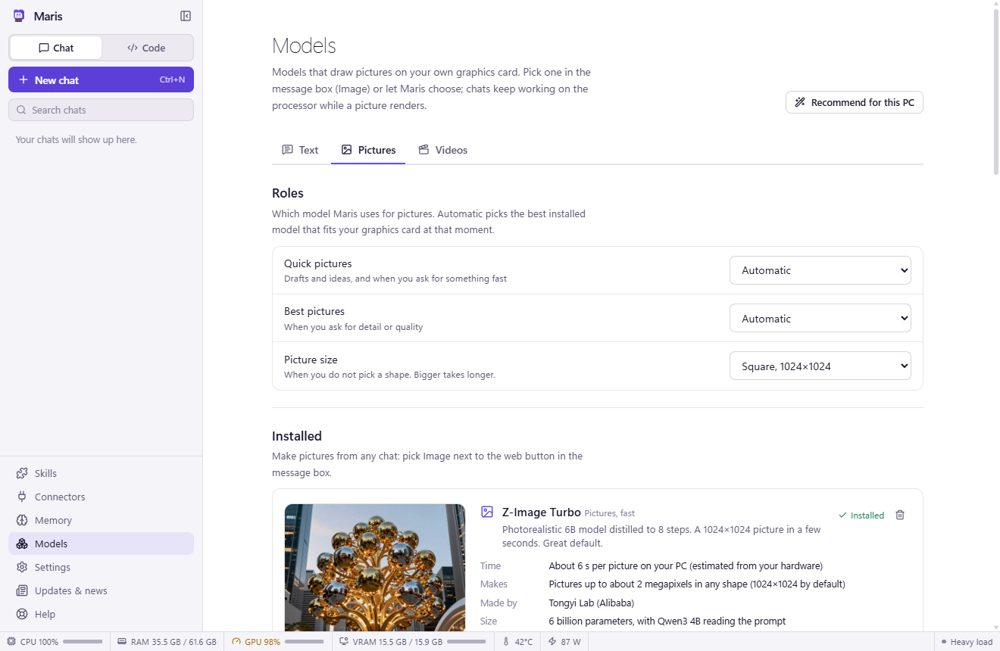
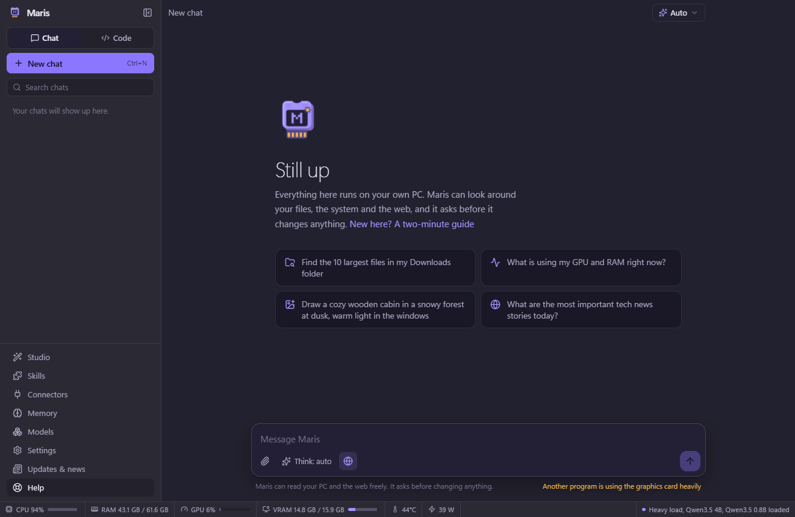
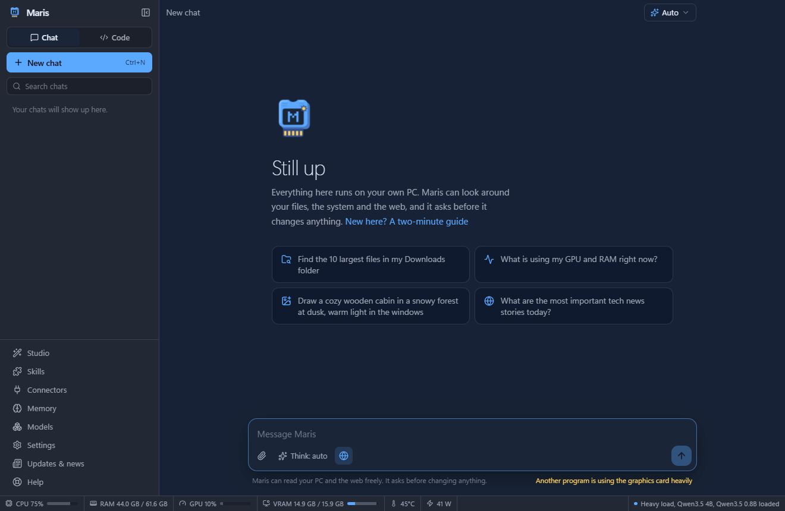

<p align="center">
  
</p>

# Maris — a private AI assistant for Windows, macOS and Linux, with an Android app

Maris runs on your computer: chat, a coding agent for your projects, a PC assistant that can look at anything but **changes nothing without your approval**, long-term memory, web browsing, and picture and video generation. For each message it picks a model that suits the task and how busy the computer is.

The models run on your own machine through Ollama. If you want, Maris also answers with **Claude, GPT, Gemini or any OpenAI-compatible service** through your own API key, with the same tools and the same approvals, and it always shows which chats leave the computer.

A setup assistant scans the computer and chooses models that suit it, from a 24 GB graphics card down to an old laptop with 4 GB of memory and no graphics card at all. Maris runs on **Windows**, **macOS** (Apple chips and Intel) and **Linux** (NVIDIA, AMD, Intel or CPU only), and the **Android app** uses it from your phone over your home Wi-Fi, end-to-end encrypted.

**[Download the latest release](https://github.com/MarySueXLsD/Maris-Local-AI/releases/latest)**. After the first install, Maris updates itself.

<p align="center">
  
</p>

## Screenshots

<table>
  <tr>
    <td width="50%"><b>Nothing changes without your OK.</b><br></td>
    <td width="50%"><b>Code mode</b> explores, edits, builds and tests a project.<br></td>
  </tr>
  <tr>
    <td><b>Pictures and videos</b> straight from the message box.<br></td>
    <td><b>Models</b> for every role, with examples and timings.<br></td>
  </tr>
  <tr>
    <td><b>Any model</b>: your own, or Claude, GPT and others with your key.<br></td>
    <td><b>Old computers</b> get one small model and low-power mode.<br></td>
  </tr>
  <tr>
    <td><b>Dark mode</b> on every screen.<br></td>
    <td><b>Themes</b>, or build your own from five colours.<br></td>
  </tr>
</table>

## Install

Get the file for your system from the [latest release](https://github.com/MarySueXLsD/Maris-Local-AI/releases/latest). `SHA256SUMS.txt` there lists the SHA-256 of every file.

| System | File | Notes |
| --- | --- | --- |
| Windows 10/11 | `Maris-<version>-Windows-Setup.exe` | Installs for you or for everyone. The Extras page offers a desktop shortcut, the `maris` terminal command, "Open in Maris" for folders and starting in the background. The installer is not code-signed yet, so SmartScreen asks once (**More info → Run anyway**); see [signing and antivirus](docs/signing-and-antivirus.md). |
| macOS 12+ | `…-macOS-Apple-silicon-arm64.dmg` (M1 and newer) or `…-macOS-Intel-x64.dmg` | Not notarized yet: the first time, right-click Maris → **Open** (macOS 15: System Settings → Privacy & Security → **Open Anyway**). Pictures and video need an Apple chip. |
| Linux | `install-maris-linux.sh`, or a package below | The installer picks the right package and checks it: `curl -fsSL https://github.com/MarySueXLsD/Maris-Local-AI/releases/latest/download/install-maris-linux.sh \| bash` |
| | `…-Linux-x64-Debian-Ubuntu.deb` | Debian, Ubuntu, Mint, Pop!_OS: `sudo apt install ./Maris-*.deb` |
| | `…-Linux-x64-Fedora-openSUSE.rpm` | Fedora, openSUSE, RHEL: `sudo dnf install ./Maris-*.rpm` |
| | `…-Linux-x64.AppImage` or `…-Linux-ARM64.AppImage` | Any distribution: `chmod +x` and run (needs FUSE 2, `libfuse2t64` on Ubuntu 24.04). |
| Android 7+ | `Maris-Link-<version>-Android.apk` | Connects to Maris on your computer; see [Phone app](#phone-app). |

On first start the **setup assistant** scans the graphics card, CPU, RAM and disks (changing nothing), lets you choose **GPU only**, **GPU + CPU** or **CPU only**, recommends a model for every role and installs [Ollama](https://ollama.com), the models and [ComfyUI](https://www.comfy.org) for pictures and video. Run it again from **Settings → Data and setup**. You can also skip the downloads and add an API key under **Models → API** instead.

## Features

- **Chat**: Markdown, code, math and tables, attachments, thinking, regenerate with another model. Answers stay in your language, and paths in answers open the folder. The context ring next to Send shows what fills the chat and lets you pick the window size, from 4K up to 2M tokens, with what each size costs in speed and memory on your computer (or per message, for an API model).
- **Code mode**: pick a project folder and Maris explores, edits several files at once, builds, runs tests and dev servers, and keeps a visible plan. A file tree, a viewer where you can mention selected lines, and a list of changes with diffs and one-click revert.
- **Automatic model choice**: every message goes to the Fast, Balanced or Max model, stepping down when a game or another program needs the graphics card, on battery, or while pictures render.
- **API models** (optional): **Models → API** connects Claude, OpenAI, Google Gemini, OpenRouter, Groq, Mistral, DeepSeek, xAI, LM Studio, a llama.cpp server or any OpenAI-compatible address. Maris reads each service's model list from the service, so new models appear without an update, and it learns what a model cannot do (tools, pictures, thinking, a refused option) from the service's own replies instead of from a list in the app. An API model answers only when you pick it for a chat or give it a role; those chats carry a cloud, and keys are stored with the system keychain.
- **Slow computers**: without a usable graphics card and with little memory or an old processor, setup picks one small model for every role and **low-power mode** turns on: short instructions, only the tools a request needs, no background model calls and a plain window. Models without tool calling of their own get the tools described in text and can still use them.
- **Approvals**: reading is free; creating, editing, deleting, commands that change things and opening programs wait for **Approve**. Deletes go to the Recycle Bin or Trash and edited files are backed up. **Always approve** rules are optional, always visible and switch off in one click.
- **Full control** (off until you turn it on, also from a button Maris shows in the chat when a task needs it): run things as administrator and use the mouse and keyboard in other programs, each action approved by you.
- **Memory** that learns facts and preferences from your chats; everything is editable.
- **Web**: search and read pages in a hidden sandboxed browser.
- **Pictures and videos** with Z-Image, Stable Diffusion 1.5 and Wan 2.1 / 2.2 through ComfyUI, with progress, time left and **Stop**.
- **Skills** (`SKILL.md` folders from git or disk) and **Connectors** to MCP servers such as GitHub, Notion or Home Assistant. Connector actions that change things need approval too.
- **Closing**: closing the window closes Maris completely, unloads its models and stops the Ollama server, so no video memory stays in use; it asks first if an answer, a picture or a download is still going. Staying in the tray is a setting, and frees video memory after a minute.
- **Status bar** with CPU, RAM, GPU, VRAM, temperature, power and loaded models. When other programs fill half the VRAM, it lists the biggest and can end one after asking.
- **Help** with plain-language articles, explanations on hover, and a Simple view for people who do not program.
- **Themes**: light and dark, seven colour themes and a custom one. Full keyboard use, screen-reader labels, text size, high contrast and reduced motion.
- **Settings**: every option is searchable, resettable and can be exported. Ask Maris in the chat to change one; it asks every time.

### Models it picks

| Computer | Typical picks |
| --- | --- |
| No graphics card, 4 GB RAM, a processor from 2012 | Qwen3 0.6B for everything, low-power mode |
| No graphics card, 8 GB RAM | Phi-4 mini for everything, low-power mode; Stable Diffusion 1.5 for pictures |
| No graphics card, 32 GB RAM | Gemma 4 E4B / 12B, Qwen3.6 35B-A3B; Stable Diffusion 1.5 for pictures |
| 8 GB graphics card | Qwen3.5 2B / 4B / 9B; Z-Image Turbo Lite; Wan 2.1 1.3B for video |
| 16 GB graphics card | Qwen3.5 4B / 9B, Qwen3.8 27B; Z-Image Turbo and Base; Wan 2.2 5B and A14B |
| 24 GB graphics card | Qwen3.8 27B fully on the graphics card |

With **GPU + CPU**, bigger models spill into system RAM: slower, but smarter. Any model can be swapped in **Models**, which also lists small and older models for slow computers.

## Phone app

Turn on **Settings → Phone**, press **Pair a phone**, and scan the QR code with the app. The phone shows the same chats, Code mode, approvals, pictures and settings; everything still runs on the computer.

The link is off by default and only accepts phones on your own network (or a VPN such as Tailscale). Pairing uses a one-time code and an ECDH key exchange, and every message is encrypted with AES-256-GCM and protected against replay. The phone cannot install updates, run setup or change the link settings, and approving from the phone can be turned off.

## Terminal command

```text
maris                                 chat in the terminal
maris "how much space is left?"       ask once
maris code . "fix the failing test"   work on this folder
git diff | maris "write a commit message for this"
maris image "a red fox in fresh snow" --open
```

It uses the same models, memory and approvals as the app (answer **y**/**n** right in the terminal) and starts Maris in the background if needed. Turn it on in the Windows installer or in **Settings → Window and startup**.

## Updates and news

Maris checks this repository's GitHub releases every 6 hours, downloads a new version in the background and checks its SHA-256. **Restart to update** in the sidebar installs it silently, keeping your choices. The news page shows posts from the [`news/`](news/README.md) folder: any Markdown file there is a post.

To ship a version, set `version` in `package.json`, optionally write `release-notes/v<version>.md`, commit and push the tag `v<version>`. The [build workflow](.github/workflows/build.yml) tests and builds every platform and publishes the release.

## Develop

```bash
npm install
npx install-electron   # the Electron binary
npm run dev            # the app with hot reload
npm test               # unit tests
npm run build          # production bundle in out/
npm run dist           # Windows installer in release/windows/
```

`npm run dist:mac` and `npm run dist:linux` build on those systems, and `npm run mobile:apk` builds the Android app. End-to-end tests live in [`tests/e2e/`](tests/e2e) and run against a throwaway profile; each file says how to run it. The ones for API models, low-power mode and closing use [`fixtures/mock-llm.mjs`](tests/e2e/fixtures/mock-llm.mjs), a stand-in for Ollama, OpenAI-style services and Claude, so they need no key, no downloads and no graphics card.

Built with Electron, React, Tailwind, [Ollama](https://ollama.com) for language models, [ComfyUI](https://www.comfy.org) for pictures and video, and Anthropic's official SDK for Claude. App data lives in `%APPDATA%\Maris`, `~/Library/Application Support/Maris` or `~/.config/Maris`; models and creations live in the data folder chosen during setup.

[Privacy](docs/privacy.md) · [Security](SECURITY.md) · [Signing and antivirus](docs/signing-and-antivirus.md)
