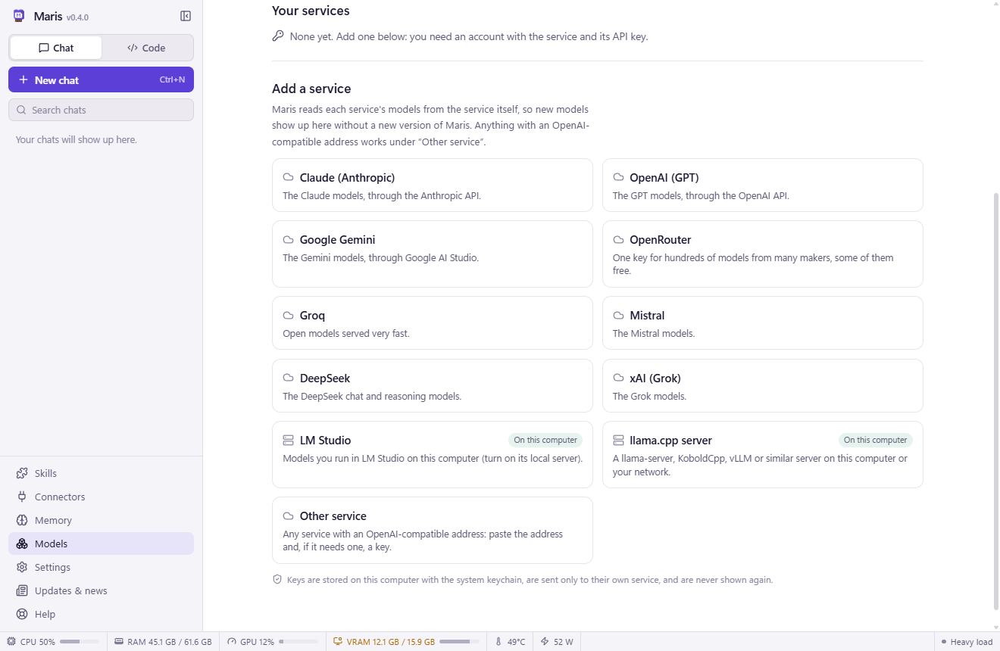
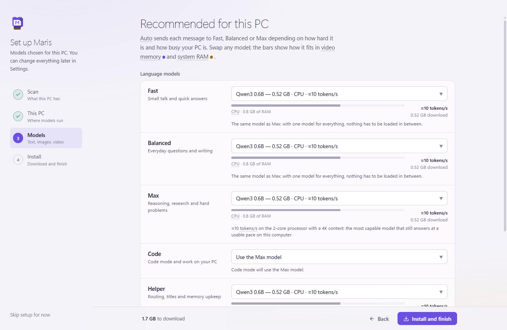

# Maris 0.4.0: any model, any computer

Until now Maris had one way to think: a model running on your own computer. That is still the heart of it, and nothing about it changes. But two kinds of people kept being left out: those whose computer is too slow for a good model, and those who already pay for Claude or GPT and want Maris's tools, approvals and memory around it. This version is for both.

## Claude, GPT, Gemini and the rest, with your own key

**Models → API** is new. Pick a service, paste your API key, and its models appear in the model menu of every chat. Claude, OpenAI, Google Gemini, OpenRouter, Groq, Mistral, DeepSeek and xAI are one click each. LM Studio, a llama.cpp server or any other OpenAI-compatible address works too, including ones on your own computer.

Everything Maris does works with these models: reading files, running commands, Code mode, memory, connectors. And it still **asks before it changes anything**.

Three things I cared about while building it:

- **No update needed for new models.** Maris reads each service's model list from the service itself, once a day and whenever you press Refresh. A model that comes out tomorrow is in your menu tomorrow.
- **No list of what each model can do.** Maris asks the service, and where the service does not say, it finds out from the first refusal and remembers. A model that cannot call tools gets them described in plain text instead, and it works. A model that refuses a setting simply stops getting that setting.
- **You always know where a chat goes.** An API model is used when you pick it for a chat or give it a role, never behind your back. A small cloud marks those chats, and the line under the message box says where your message will be sent before you send it. Chats with models on your computer stay on your computer, exactly as before.

Your keys are stored encrypted with your system's keychain and are sent only to their own service. The service bills your account for what you send; Maris adds nothing on top.

Long work fits too. The context ring next to Send (and Settings) now goes **up to 1M and 2M tokens**: for an API model that is the budget for how much of a long chat is sent with each message, never more than the model takes. It costs more per message the fuller it gets, and the ring says so.

## Old and slow computers

Maris now takes computers without a graphics card seriously, down to a laptop from 2012 with 4 GB of memory.

The setup assistant measures the processor, not only the memory, and on a slow computer picks **one small model for everything** instead of three that would keep swapping. A 2012 dual-core with 4 GB gets Qwen3 0.6B, which should write at about reading speed there. An office laptop with 8 GB gets Phi-4 mini.

On such a computer **low-power mode** turns itself on. Maris sends the model short instructions and only the tools your request needs, about a quarter of the usual text, so the answer starts much sooner. It makes no extra model calls in the background, keeps the context small, and the window drops its blur and animations. You can switch it under Settings → Engine.

Very small and older models have no tool calling of their own. They can use Maris's tools now anyway: Maris describes them in text and reads the model's request back out of its answer.

And if you want strong answers on a weak computer, add an API key. The two work side by side.

## Closing Maris now really closes it

Closing the window used to leave Maris in the tray with its models still in the graphics card's memory. Now closing the window **closes Maris completely**: answers are stopped, models are unloaded, and the Ollama server is stopped too, so nothing keeps using your video memory.

If an answer, a picture, a video or a download is still going, Maris **asks first** whether you really want to close. What was written so far stays in the chat.

Prefer the old way? Settings → Window and startup → **Keep running in the tray when closed** brings it back, and even then Maris now gives the video memory back about a minute after its window closes. If you use Ollama with other programs, Settings → Engine → **Stop Ollama when Maris closes** leaves the server alone.

## Smaller things, and things that were broken

- The model's instructions no longer change with every message, so models that cache their prompt (Claude, and Ollama itself) answer follow-up messages faster.
- On computers without a graphics card, an answer could give up after a few minutes while the model was simply still reading. The wait now grows with the length of the prompt.
- A status bar on computers without GPU counters restarted a system tool twice a second. It gives up politely now.
- Maris's own work on the processor no longer counts as "other programs are keeping the processor busy", which pushed chats to a smaller model for no reason.
- Projects on drives that Windows formats without owners (exFAT, many USB and external drives) said "not a git repository". They work.
- The same project opened with a different spelling of its path no longer shows up twice.
- A chat whose first answer was stopped keeps a real name instead of "New chat".
- Folders named `build`, `bin` or `packages` are only skipped in searches when they really are build output.
- Undo in Code mode can only restore Maris's own backups, also from the phone app.
- On Windows 10 the window is no longer grey behind the content.
- Editing a message that asked for a picture keeps asking for a picture.
- Token counts for Russian, Chinese, Japanese and other non-Latin text are far closer to the truth, so long chats in those languages are summarised at the right time.

## Getting it

Maris updates itself: when 0.4.0 has been downloaded, **Restart to update** appears in the sidebar. New here? The [latest release](https://github.com/MarySueXLsD/Maris-Local-AI/releases/latest) has installers for Windows, macOS and Linux, and the Android app.

Help has three new pages if you want the details: **Claude, GPT and other API models**, **Maris on a slow or old computer** and **Closing Maris**. Press F1.
